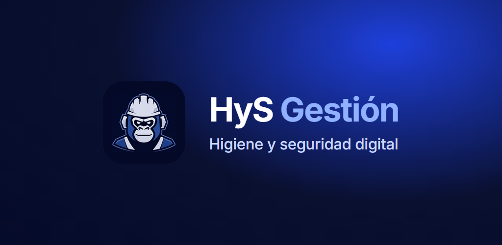
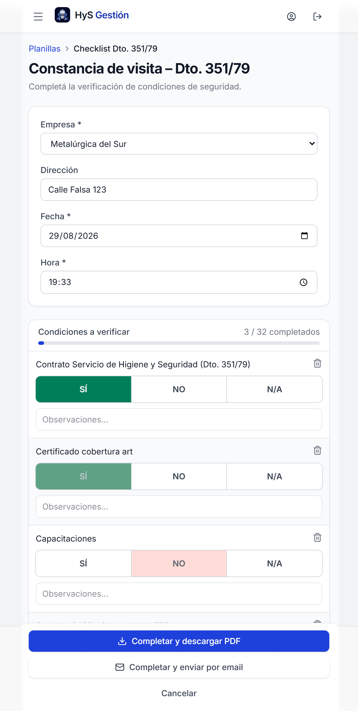
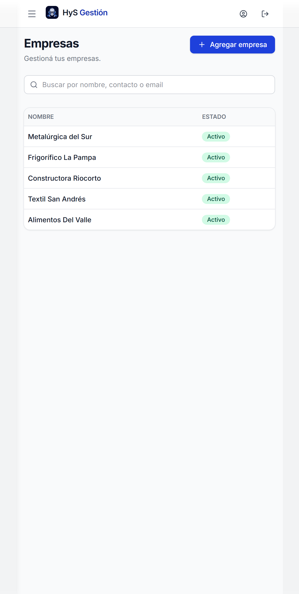
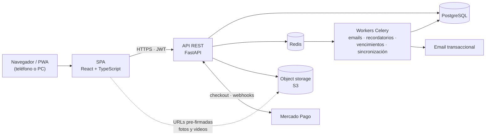

  

  <b>Plataforma SaaS para profesionales de Higiene y Seguridad laboral en Argentina.</b> 
  Planillas normativas, firma digital, capacitaciones, agenda e informes, desde el teléfono o la computadora.

  <a href="https://hysgestion.com"><b>hysgestion.com</b></a>

---

> **Sobre este repositorio:** este es el repositorio público de presentación del proyecto.
> El código fuente está en un repositorio privado. Acá se describe qué hace el sistema, cómo
> está construido y en qué estado está.

## El problema

Un profesional de Higiene y Seguridad atiende a varias empresas a la vez. En cada visita releva
condiciones según la normativa (Decreto 351/79, Decreto 911/96 para la construcción), deja
constancia firmada, dicta capacitaciones y lleva una agenda de vencimientos. Casi siempre ese
trabajo se hace en papel, en planillas de Excel sueltas y en el correo. La evidencia queda
dispersa y cuesta demostrar qué se hizo para cada cliente y cuándo.

**HyS Gestión** concentra ese trabajo en una sola aplicación pensada para usarse en planta,
desde el teléfono.

## Qué hace

| Módulo | Descripción |
|---|---|
| **Empresas cliente** | Cartera de empresas con su ficha: planillas cargadas, actividades, capacitaciones enviadas y evidencia fotográfica (con la cámara del teléfono, con reescalado automático antes de subir). |
| **Checklists normativas** | Constancia de visita según **Dto. 351/79** (32 ítems) y **Dto. 911/96** (46 ítems), con respuestas SÍ / NO / N/A, observaciones y medidas preventivas que se sugieren solas ante cada "NO". |
| **Planillas propias** | El profesional define sus propios tipos de planilla y los reutiliza. Cada tipo guarda su propio historial. |
| **Firma digital y PDF** | Se firma en pantalla (profesional y responsable de la empresa, con DNI). El PDF incluye fecha y hora de servidor y un **hash SHA-256 de integridad** sobre el contenido firmado. Se descarga o se envía por email al cliente. |
| **Capacitaciones** | Material (documentos, fotos y video) que se envía por email a las empresas. El video se ve con un **enlace propio por empresa** que vence a los 30 días. Se registran las reproducciones y la evaluación se hace con Google Forms. |
| **Agenda** | Actividades con estados, asignación a miembros del equipo, **recordatorios automáticos por email** e importación de Google Calendar en solo lectura. |
| **Métricas e informes** | Dashboard con KPIs, tendencias mensuales y semanales, comparación entre períodos y un **semáforo de cartera** por empresa (al día, atención, atrasada). Exporta a PDF y CSV. |
| **Equipo** | El titular invita colaboradores por email. Cada miembro ve solo lo suyo y el titular ve todo. |
| **Suscripciones** | Prueba gratuita de 30 días y luego suscripción mensual con **Mercado Pago**, con límites por plan. Si la suscripción vence, la cuenta pasa a solo lectura y no se pierde ningún dato. |
| **Privacidad** | El titular puede exportar toda su información y dar de baja la cuenta desde la propia app (Ley 25.326). |

## Capturas

  
  &nbsp;&nbsp;
  

Datos de demostración.

## Cómo está construido

Es un **monolito modular** con una **SPA** separada. Es multi-tenant con aislamiento por fila: cada
consulta de negocio se filtra por cuenta, y hay un mecanismo automático que, si falta ese filtro,
no devuelve nada en lugar de devolver datos de otra cuenta.

### Stack

| Capa | Tecnologías |
|---|---|
| **Backend** | Python 3.11 · FastAPI · SQLAlchemy 2 · Alembic · Pydantic v2 · Celery + Redis · ReportLab (PDF) |
| **Frontend** | React 18 · TypeScript · Vite · Tailwind CSS · React Router · Recharts · PWA instalable (Service Worker) |
| **Datos** | PostgreSQL 15 (JSONB para planillas dinámicas) · almacenamiento S3 (MinIO en desarrollo) |
| **Infraestructura** | Docker Compose · AWS · Cloudflare · Caddy (TLS) |
| **Pagos y email** | Mercado Pago (suscripciones) · SMTP transaccional |
| **Observabilidad** | Sentry · monitoreo con alertas · backups con restauración probada |

### Calidad y operación

- **446 tests de backend** (pytest, contra PostgreSQL real), con **~87 % de cobertura**.
- **143 tests end-to-end** (Playwright), que el CI corre contra el **build de producción**.
- **Deploy continuo:** cada cambio en `main` pasa por tests, build, migraciones y health-check, y
  si algo falla vuelve solo a la versión anterior.
- **Seguridad:** JWT con refresh tokens, contraseñas con bcrypt, rate limiting, validación de
  firma en los webhooks de pago, secretos cifrados en reposo y Content Security Policy.
- **Documentación completa** del análisis (requerimientos, reglas de negocio, casos de uso), la
  arquitectura, el modelo de datos, el registro de deuda técnica y los runbooks de producción.

## Estado

- En producción desde julio de 2026 en [hysgestion.com](https://hysgestion.com).
- Facturación con Mercado Pago activa.
- PWA instalable desde el navegador. La versión para Google Play está en etapa de prueba.

## Origen

El proyecto nació como **tesis universitaria** y hoy funciona como producto comercial. Lo
desarrolló una sola persona, de punta a punta: análisis, diseño, backend, frontend,
infraestructura y operación.

**Autor:** Mauricio Cattoni · [GitHub](https://github.com/MauricioCattoni)

---

© 2026 Mauricio Cattoni. Todos los derechos reservados. Este repositorio es solo de
presentación y no incluye el código fuente.
